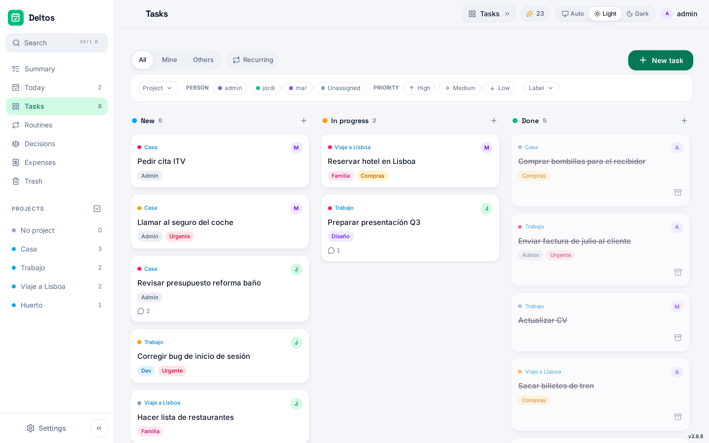
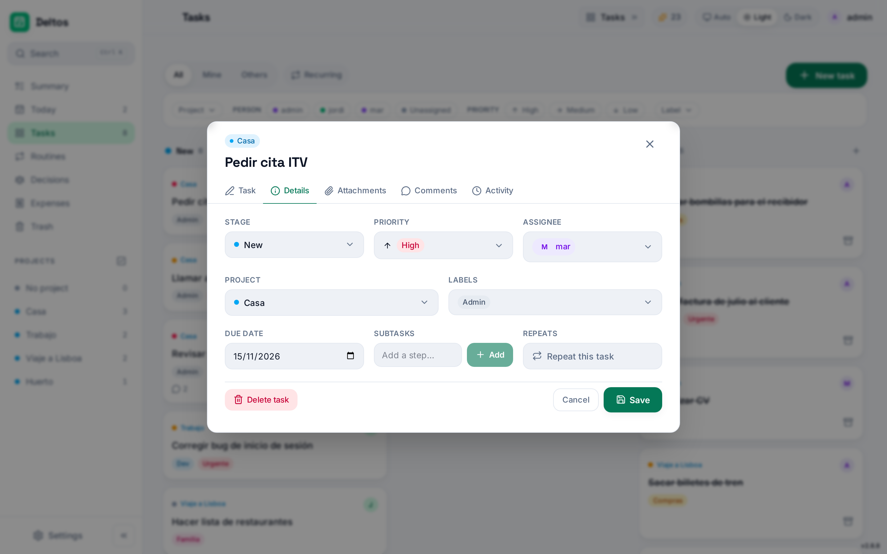
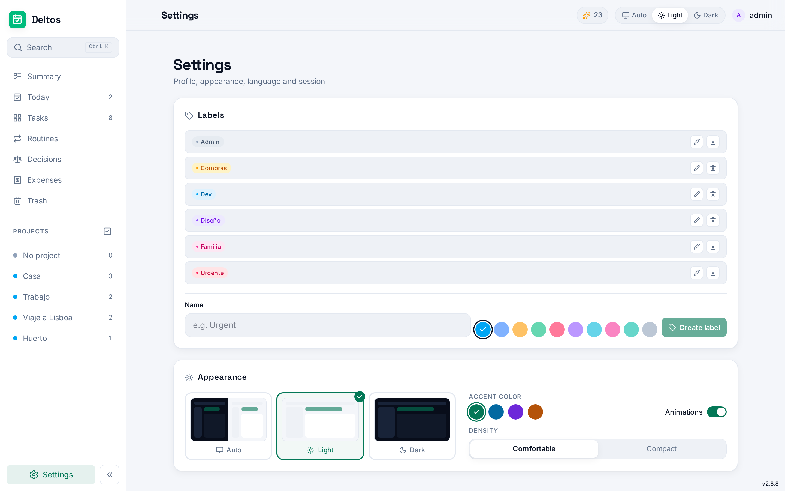
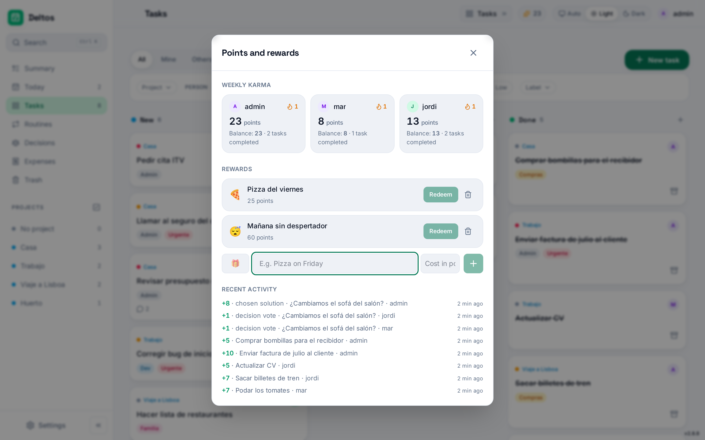
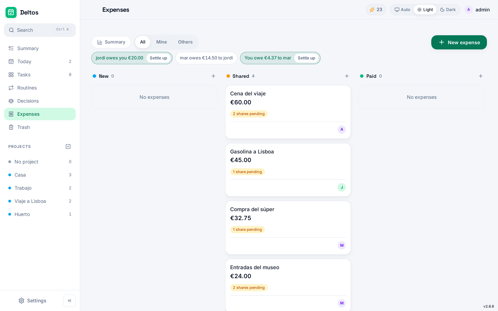

# Deltos

<p align="center">
  <a href="README.md">English</a> |
  <a href="README.es.md">Español</a>
</p>

<p align="center">
  <a href="https://deltos.cloudless.club"></a>
  <a href="https://github.com/gnacho/deltos/releases"></a>
  <a href="https://github.com/gnacho/deltos/actions/workflows/release.yml"></a>
  <a href="LICENSE"></a>
  <a href="https://ko-fi.com/gnacho"></a>
</p>

<p align="center">
  <picture>
    <source media="(prefers-color-scheme: dark)" srcset="assets/hero-es-dark.png">
    <source media="(prefers-color-scheme: light)" srcset="assets/hero-es-light.png">
    
  </picture>
</p>

Deltos es una PWA de gestión de tareas para el día a día: un tablero kanban
compartido con sincronización en vivo, comentarios, adjuntos y notificaciones
push, servido por un único binario estático en Go con SQLite al lado. Vale para una pareja, una
familia, un grupo de amigos organizando un viaje o un equipo pequeño, sin la
complejidad de las herramientas grandes y sin tus datos en la nube de otro.

## El nombre

Deltos viene del griego antiguo _δέλτος_ (déltos): una tablilla de escritura
y, por extensión, cualquier escrito o documento. Antes del papel, así se
anotaba lo que importaba recordar. El nombre le pega a una app cuyo propósito
es justamente poner las tareas por escrito y tenerlas a la vista de quienes
las comparten.

## ¿Por qué existe?

Deltos nació como el tablero de un viaje con amigos: seis personas, una hoja
de cálculo que nadie actualizaba y un chat donde cada decisión se perdía.
Luego lo seguimos usando en casa para lo cotidiano, y otra vez durante una
reforma y la mudanza que vino detrás. Todo lo que habíamos probado pedía
cuenta y suscripción, guardaba nuestras listas en el servidor de otro, o
traía más proceso del que una familia necesita. Así que construí lo pequeño:
un servicio, un único fichero de base de datos y un tablero que se sincroniza
en vivo. Hace menos que Trello o Jira, y para nosotros esa era la idea.

## ¿Por qué este stack?

- **Go 1.25 + chi + modernc.org/sqlite**: un binario estático, sin CGO y sin
  runtime que instalar. El servidor es sobre todo E/S (sync en vivo por SSE,
  subidas, unos pocos usuarios concurrentes), y la librería estándar más un
  router pequeño cubren eso sin impuesto de framework.
- **SQLite, sin base de datos externa**: un fichero en `/var/lib/deltos`,
  modo WAL; un backup es copiar un archivo. Nada que administrar para unos
  pocos usuarios.
- **systemd tras Nginx Proxy Manager, sin Docker**: corre en un LXC pequeño
  en casa; menos capas, logs en journald y una release es un directorio más
  un symlink `current`. Docker en producción no está soportado: el despliegue
  previsto es un LXC o VM pequeño con systemd.
- **React 19 + Vite + Tailwind**: la shell de UI (sidebar, temas, i18n,
  ajustes) es compartida con mis otras apps, así que un arreglo llega a
  todas a la vez. Se compila una vez y el binario Go la sirve como estáticos.

## Características

- **Kanban compartido**: columnas Nuevo / En curso / Hecho con arrastrar y
  soltar, en vivo entre sesiones vía SSE (sin recargar, sin polling).
- **Notificaciones push**: Web Push (VAPID) cuando alguien crea, mueve,
  comenta o te asigna una tarjeta, incluso con la app cerrada. Dormido en
  HTTP plano; se activa solo cuando la app se sirve por HTTPS.
- **Tarjetas con todo**: comentarios, adjuntos con visor de imágenes en la
  app, etiquetas, prioridad, vencimiento y feed de actividad por tarjeta.
- **Tareas periódicas**: "cada dos semanas", "todos los lunes", escrito en la
  caja de la tarea; el parser entiende fechas ES/EN y la recurrencia se adapta
  a cuándo completas de verdad.
- **Gastos compartidos**: quién pagó, partes por persona, invitaciones por
  enlace público para quien no tiene cuenta, saldar cuentas y el flujo
  nuevo / repartido / pagado. Detrás de un flag que activas por instalación.
- **Decisiones**: un proceso de consejo junto al tablero. Propón opciones,
  vota, elige una (o ciérrala sin elegir) y deja el razonamiento escrito.
- **Puntos y recompensas**: completar una tarea da puntos. Karma semanal,
  rachas y un catálogo de recompensas reales que definís vosotros. Si lo
  ignoras, el tablero funciona exactamente igual.
- **Multiusuario**: roles admin/usuario, idioma por usuario (ES/EN),
  contraseñas bcrypt, login con rate-limit y registro de auditoría.
- **PWA instalable**: tema claro/oscuro siguiendo al sistema, service
  worker offline y "comprobar actualizaciones" contra GitHub releases desde
  Ajustes.
- **Modo demo con un clic**: base de datos sembrada aparte, sin contraseña;
  desactivable en Ajustes.
- **Almacenamiento SQLite**: modo WAL, un único fichero en `/var/lib/deltos`.

## Capturas

**Detalle de tarjeta:** pestañas de detalles, adjuntos, comentarios y actividad**

<picture>
  <source media="(prefers-color-scheme: dark)" srcset="assets/screenshot-task-es-dark.png">
  <source media="(prefers-color-scheme: light)" srcset="assets/screenshot-task-es-light.png">
  
</picture>

**Ajustes:** apariencia con color de acento, perfil, etiquetas, idioma**

<picture>
  <source media="(prefers-color-scheme: dark)" srcset="assets/screenshot-settings-es-dark.png">
  <source media="(prefers-color-scheme: light)" srcset="assets/screenshot-settings-es-light.png">
  
</picture>

**Puntos y recompensas:** karma semanal, rachas y premios que definís vosotros**

<picture>
  <source media="(prefers-color-scheme: dark)" srcset="assets/screenshot-rewards-es-dark.png">
  <source media="(prefers-color-scheme: light)" srcset="assets/screenshot-rewards-es-light.png">
  
</picture>

**Gastos compartidos:** quién pagó, partes por persona, invitar por enlace y saldar cuentas**

<picture>
  <source media="(prefers-color-scheme: dark)" srcset="assets/screenshot-expenses-es-dark.png">
  <source media="(prefers-color-scheme: light)" srcset="assets/screenshot-expenses-es-light.png">
  
</picture>

## Instalación

Requisitos: Linux (x86_64 o arm64) con systemd, acceso root o sudo.

```sh
curl -fsSL https://raw.githubusercontent.com/gnacho/deltos/main/install.sh | sudo sh   # (recomendado)
```

El instalador es un script POSIX shell legible y sin dependencias.
[Inspecciónalo antes de ejecutarlo](install.sh): para eso se mantiene
simple. Detecta tu distro/arquitectura, descarga la última release y
**verifica su checksum SHA-256**, instala la release (`deltos-go` y el
frontend compilado) en `/opt/deltos/releases` tras un symlink `current`,
crea un servicio systemd `deltos` enjaulado y muestra la contraseña inicial
de admin una sola vez.

Ejecutar el mismo comando más adelante actualiza a la última release. También
puedes actualizar desde Ajustes en la app, o dejar que el timer semanal
`deltos-update` lo haga; ambos pasan por el mismo updater con checksum. El
rollback es volver el symlink `current` a la release anterior y reiniciar.
Para desinstalar: `curl -fsSL https://raw.githubusercontent.com/gnacho/deltos/main/install.sh | sudo sh -s -- --uninstall`.

<details>
<summary><strong>Instalación manual (desde tarball de release)</strong></summary>

Descarga el artefacto de tu arquitectura desde
[Releases](https://github.com/gnacho/deltos/releases/latest) y verifícalo
contra `checksums.txt` (`sha256sum -c checksums.txt --ignore-missing`). El
tarball lleva `deltos-go`, `dist/` (el frontend compilado), `deploy/` (units
de systemd, scripts de update y backup) y este instalador. Para lanzarlo a
mano:

```sh
tar xzf deltos_<version>_linux_amd64.tar.gz -C /opt/deltos
cd /opt/deltos
PORT=3000 DATA_DIR=/var/lib/deltos STATIC_DIR=/opt/deltos/dist ./deltos-go
```

No hace falta compilador ni runtime en el servidor: es un binario estático.
Para un servicio, usa las units de `deploy/` (o simplemente el instalador).

</details>

## Configuración

El servicio lee su entorno (instalador: `/etc/deltos/env`):

| Variable            | Default                 | Descripción |
| ------------------- | ----------------------- | ----------- |
| `PORT`              | `3000`                  | Puerto de escucha (tras Nginx Proxy Manager). |
| `DATA_DIR`          | `/var/lib/deltos`       | Ficheros SQLite + uploads. |
| `STATIC_DIR`        | `./static` (instalador: `/opt/deltos/current/dist`) | Frontend compilado a servir. |
| `AUTH_USER`/`AUTH_PASS` | - | Admin de arranque en el primer boot (idempotente). |
| `COOKIE_SECURE`     | `false`                 | `true` solo tras HTTPS. |
| `TRUSTED_PROXY`     | - | Dirección(es) del proxy inverso autorizadas a fijar `X-Forwarded-For`. |
| `SESSION_SECRET`    | auto-generado           | Secreto HMAC; se persiste en la BD si no se define. |
| `MAX_SSE_CLIENTS`   | `20`                    | Clientes de sync en vivo concurrentes. |
| `MAX_UPLOAD_MB`     | `10`                    | Tamaño máximo de adjunto. |
| `VAPID_PUBLIC_KEY` / `VAPID_PRIVATE_KEY` / `VAPID_SUBJECT` | - | Claves Web Push (las tres o ninguna). Genera con `npx web-push generate-vapid-keys --json`; el subject debe ser un `mailto:`. Sin ellas el push queda apagado y la app funciona igual. |

Reinicia tras cambios: `sudo systemctl restart deltos`.

## Credenciales

- **Producción**: el primer boot crea el admin desde `AUTH_USER` /
  `AUTH_PASS` (si falta `AUTH_PASS`, no se crea admin y se registra un
  aviso).
- **Demo**: botón "Entrar como demo" en la pantalla de login (sin
  contraseña). Base de datos demo aparte (`app_demo.db`), sembrada con 3
  usuarios, 4 proyectos, 6 etiquetas y 15 tareas. Desactivable en Ajustes
  (solo admin).

## Desarrollo

Stack: **Go 1.25 + chi + modernc.org/sqlite (servidor) · React 19 + Vite +
Tailwind (frontend) · HTML/CSS/TS plano (landing)**.

```bash
# Servidor (puerto 3000; lee variables de entorno o /etc/deltos/env)
cd server-go
go run ./cmd/server

# Frontend (otro terminal, con proxy al servidor en dev)
cd app
npm ci
npm run dev

# Build de producción del frontend (lo sirve el binario Go desde STATIC_DIR)
npm run build

# Landing (deltos.cloudless.club)
cd landing
npm ci
npm run build
```

Con el frontend compilado y `STATIC_DIR` apuntando a su salida, el binario Go
basta: sirve la SPA con fallback a `index.html`.

## Tests

```bash
cd server-go && go test ./...   # API, auth, SSE, NLP y recurrencia en Go
cd server && npm test           # 297 tests: el contrato de referencia que implementa el servidor Go
```

## Licencia

[AGPL-3.0](LICENSE)
