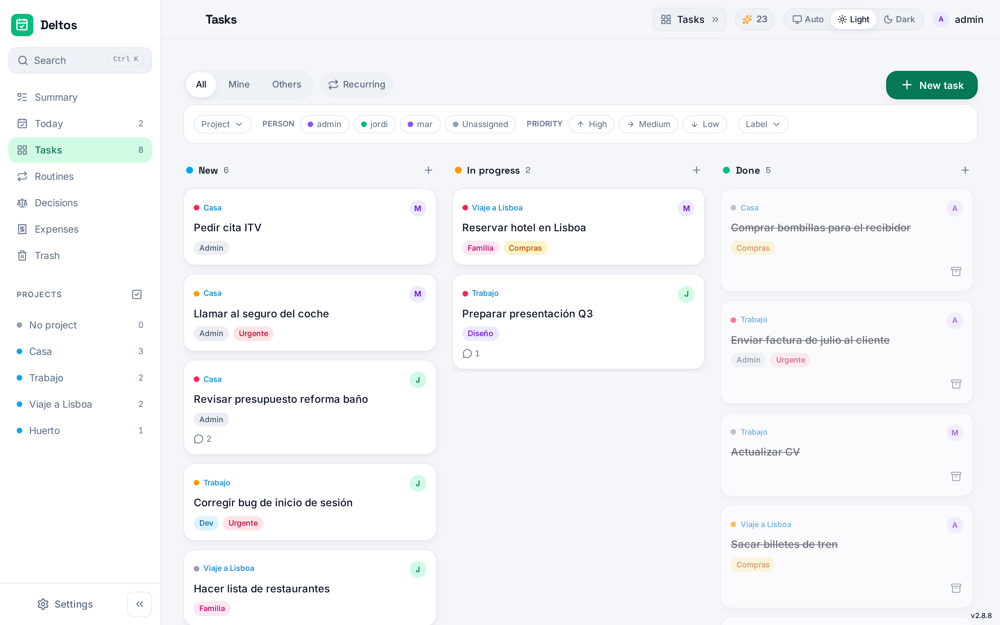
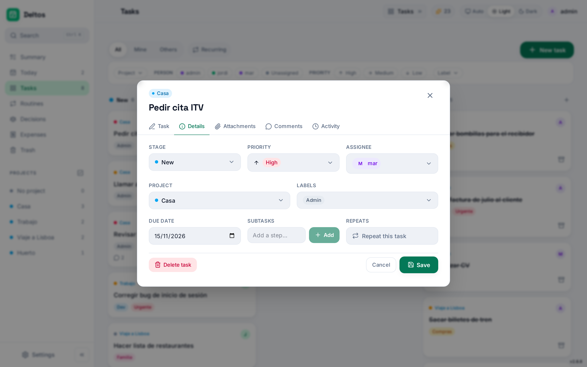
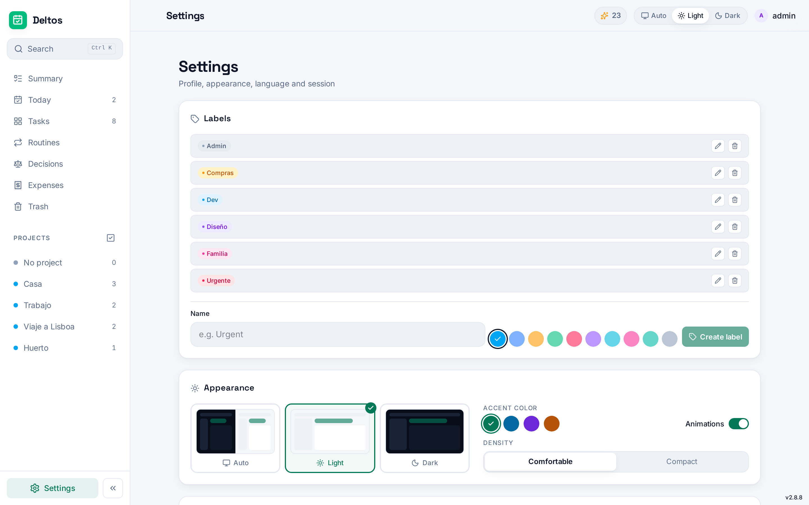
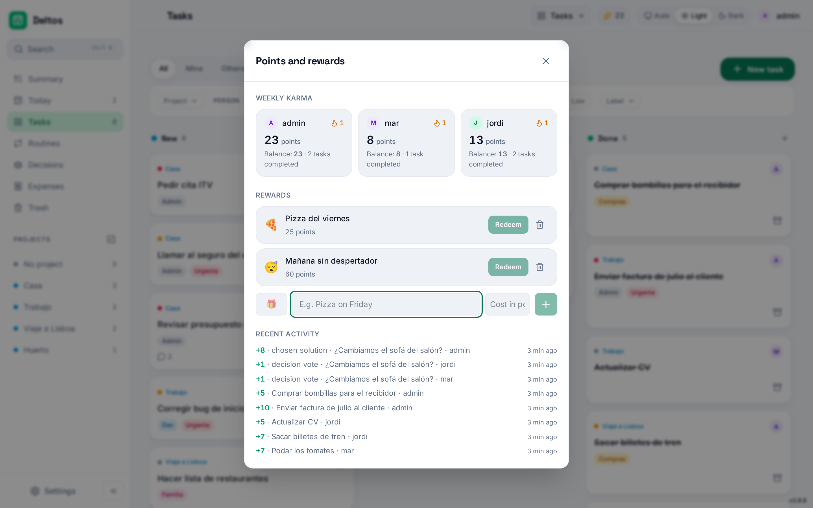
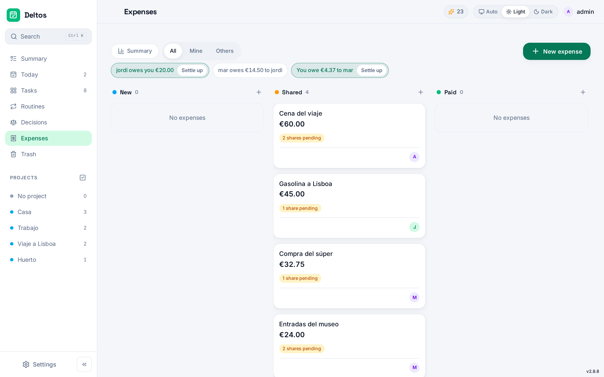

# Deltos

<p align="center">
  <a href="README.md">English</a> |
  <a href="README.es.md">Español</a>
</p>

<p align="center">
  <a href="https://deltos.cloudless.club"></a>
  <a href="https://github.com/gnacho/deltos/releases"></a>
  <a href="https://github.com/gnacho/deltos/actions/workflows/release.yml"></a>
  <a href="LICENSE"></a>
  <a href="https://ko-fi.com/gnacho"></a>
</p>

<p align="center">
  <picture>
    <source media="(prefers-color-scheme: dark)" srcset="assets/hero-en-dark.png">
    <source media="(prefers-color-scheme: light)" srcset="assets/hero-en-light.png">
    
  </picture>
</p>

Deltos is a task-management PWA for everyday life: a shared kanban board with
live sync, comments, attachments and push notifications, served by a single
static Go binary with SQLite alongside it. It works for a couple, a family, a
group of friends planning a trip, or a small team, without the complexity of
the big tools and without your data on somebody else's cloud.

## The name

Deltos comes from the ancient Greek _δέλτος_ (déltos): a writing tablet, and
by extension any written record or letter. Before paper, that was how you
kept notes on what mattered. The name fit an app whose whole point is writing
tasks down and keeping them where the people who share them can see them.

## Why does this exist?

Deltos started as the board for a friends' trip: six people, a spreadsheet
nobody updated, and a chat where every decision got buried. Then we kept
using it at home for the day-to-day stuff, and again through a renovation
and the move that came with it. Everything we had tried before wanted an
account and a subscription, kept our lists on someone else's server, or
brought more process than a family needs. So I built the small thing: one
service, one file of database, a board that syncs live. It does less than
Trello or Jira, and for us that was the point.

## Why this stack?

- **Go 1.25 + chi + modernc.org/sqlite**: one static binary, no CGO, no
  runtime to install. The server is mostly I/O (SSE live sync, uploads, a
  handful of concurrent users), and the standard library plus a tiny router
  covers that without framework tax.
- **SQLite, no external database**: one file under `/var/lib/deltos`, WAL
  mode; a backup is a file copy. Nothing to administer for a few users.
- **systemd behind Nginx Proxy Manager, no Docker**: it runs in a small LXC
  at home; fewer layers, logs in journald, and a release is a directory plus
  a `current` symlink. Docker in production is not supported: the intended
  deployment is a small LXC or VM with systemd.
- **React 19 + Vite + Tailwind**: the UI shell (sidebar, themes, i18n,
  settings) is shared with my other apps, so a fix lands everywhere at once.
  It is built once and served as static files by the Go binary.

## Features

- **Shared kanban**: New / In progress / Done columns with drag & drop, live
  between sessions over SSE (no refresh, no polling).
- **Push notifications**: Web Push (VAPID) when someone creates, moves,
  comments on or assigns you a card, even with the app closed. Dormant on
  plain HTTP; turns itself on once the app is served over HTTPS.
- **Cards with everything**: comments, attachments with an in-app image
  viewer, labels, priority, due dates and a per-card activity feed.
- **Recurring tasks**: "cada dos semanas", "every Monday", typed in the task
  box; the parser understands ES/EN dates and the recurrence adapts to when
  you actually complete things.
- **Shared expenses**: who paid, per-person shares, invitations by public
  link for people without an account, settle-up and the new / shared / paid
  flow. Behind a flag you enable per install.
- **Decisions**: an advice process next to the board. Propose options, vote,
  choose one (or close without choosing) and keep the reasoning written down.
- **Points and rewards**: completing a task earns points. A weekly karma
  board, streaks and a catalog of real-life rewards you define yourselves.
  Ignore it and the board works exactly the same.
- **Multiuser**: admin/user roles, per-user language (ES/EN), bcrypt
  passwords, rate-limited login, audit trail.
- **Installable PWA**: light/dark theme following the system, offline
  service worker, "check for updates" against GitHub releases from Settings.
- **One-click demo mode**: separate seeded database, no password; can be
  disabled in Settings.
- **SQLite storage**: WAL mode, single file under `/var/lib/deltos`.

## Screenshots

**Card detail:** tabs for details, attachments, comments and activity**

<picture>
  <source media="(prefers-color-scheme: dark)" srcset="assets/screenshot-task-en-dark.png">
  <source media="(prefers-color-scheme: light)" srcset="assets/screenshot-task-en-light.png">
  
</picture>

**Settings:** appearance with accent color, profile, labels, language**

<picture>
  <source media="(prefers-color-scheme: dark)" srcset="assets/screenshot-settings-en-dark.png">
  <source media="(prefers-color-scheme: light)" srcset="assets/screenshot-settings-en-light.png">
  
</picture>

**Points and rewards:** weekly karma, streaks and rewards you define**

<picture>
  <source media="(prefers-color-scheme: dark)" srcset="assets/screenshot-rewards-en-dark.png">
  <source media="(prefers-color-scheme: light)" srcset="assets/screenshot-rewards-en-light.png">
  
</picture>

**Shared expenses:** who paid, per-person shares, invite by link and settle up**

<picture>
  <source media="(prefers-color-scheme: dark)" srcset="assets/screenshot-expenses-en-dark.png">
  <source media="(prefers-color-scheme: light)" srcset="assets/screenshot-expenses-en-light.png">
  
</picture>

## Installation

Requirements: Linux (x86_64 or arm64) with systemd, root or sudo access.

```sh
curl -fsSL https://raw.githubusercontent.com/gnacho/deltos/main/install.sh | sudo sh   # (recommended)
```

The installer is a readable, dependency-free POSIX shell script.
[Inspect it before running](install.sh): that's the point of keeping it
plain. It detects your distro/arch, downloads the latest release and
**verifies its SHA-256 checksum**, installs the release (`deltos-go` plus the
built frontend) under `/opt/deltos/releases` behind a `current` symlink,
creates a sandboxed `deltos` systemd service and prints the initial admin
password once.

Running the same command again later upgrades to the latest release. You can
also update from Settings in the app, or let the weekly `deltos-update.timer`
do it; both go through the same checksum-verified updater. Rollback is
flipping `current` back to the previous release directory and restarting.
To uninstall: `curl -fsSL https://raw.githubusercontent.com/gnacho/deltos/main/install.sh | sudo sh -s -- --uninstall`.

<details>
<summary><strong>Manual installation (from a release tarball)</strong></summary>

Download the artifact for your architecture from
[Releases](https://github.com/gnacho/deltos/releases/latest) and verify it
against `checksums.txt` (`sha256sum -c checksums.txt --ignore-missing`). The
tarball contains `deltos-go`, `dist/` (the built frontend), `deploy/` (systemd
units, update and backup scripts) and this installer. To run it by hand:

```sh
tar xzf deltos_<version>_linux_amd64.tar.gz -C /opt/deltos
cd /opt/deltos
PORT=3000 DATA_DIR=/var/lib/deltos STATIC_DIR=/opt/deltos/dist ./deltos-go
```

No compiler and no runtime are needed on the server: it is a static binary.
For a service, use the units in `deploy/` (or just run the installer).

</details>

## Configuration

The service reads its environment (installer: `/etc/deltos/env`):

| Variable            | Default                 | Description |
| ------------------- | ----------------------- | ----------- |
| `PORT`              | `3000`                  | Listen port (behind Nginx Proxy Manager). |
| `DATA_DIR`          | `/var/lib/deltos`       | SQLite files + uploads. |
| `STATIC_DIR`        | `./static` (installer: `/opt/deltos/current/dist`) | Built frontend to serve. |
| `AUTH_USER`/`AUTH_PASS` | - | Bootstrap admin on first boot (idempotent). |
| `COOKIE_SECURE`     | `false`                 | `true` only behind HTTPS. |
| `TRUSTED_PROXY`     | - | Reverse proxy address(es) allowed to set `X-Forwarded-For`. |
| `SESSION_SECRET`    | auto-generated          | HMAC secret; persisted in the DB if unset. |
| `MAX_SSE_CLIENTS`   | `20`                    | Concurrent live-sync clients. |
| `MAX_UPLOAD_MB`     | `10`                    | Attachment size limit. |
| `VAPID_PUBLIC_KEY` / `VAPID_PRIVATE_KEY` / `VAPID_SUBJECT` | - | Web Push keys (all three or none). Generate with `npx web-push generate-vapid-keys --json`; subject must be a `mailto:`. Without them, push stays off and the app runs fine. |

Restart after changes: `sudo systemctl restart deltos`.

## Credentials

- **Production**: first boot creates the admin from `AUTH_USER` / `AUTH_PASS`
  (if `AUTH_PASS` is missing, no admin is created and a warning is logged).
- **Demo**: "Sign in as demo" button on the login screen (no password).
  Separate demo database (`app_demo.db`), seeded with 3 users, 4 projects,
  6 labels and 15 tasks. Can be disabled in Settings (admin only).

## Development

Stack: **Go 1.25 + chi + modernc.org/sqlite (server) · React 19 + Vite +
Tailwind (frontend) · plain HTML/CSS/TS (landing)**.

```bash
# Server (port 3000; reads env vars or /etc/deltos/env)
cd server-go
go run ./cmd/server

# Frontend (another terminal, proxied to the server in dev)
cd app
npm ci
npm run dev

# Production frontend build (served by the Go binary from STATIC_DIR)
npm run build

# Landing (deltos.cloudless.club)
cd landing
npm ci
npm run build
```

With the frontend built and `STATIC_DIR` pointing at its output, the Go
binary alone is enough: it serves the SPA with fallback to `index.html`.

## Tests

```bash
cd server-go && go test ./...   # Go API, auth, SSE, NLP and recurrence
cd server && npm test           # 297 tests: the reference contract the Go server implements
```

## License

[AGPL-3.0](LICENSE)
